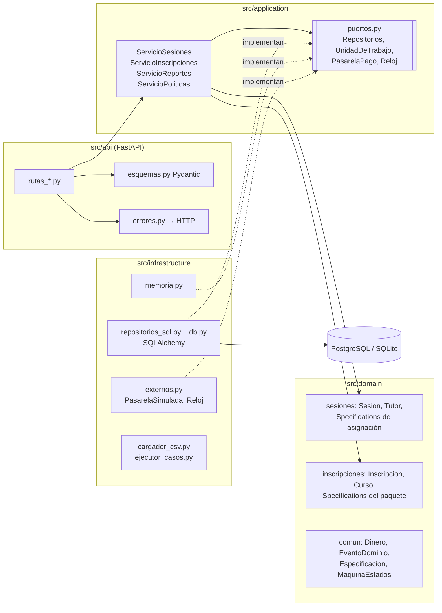
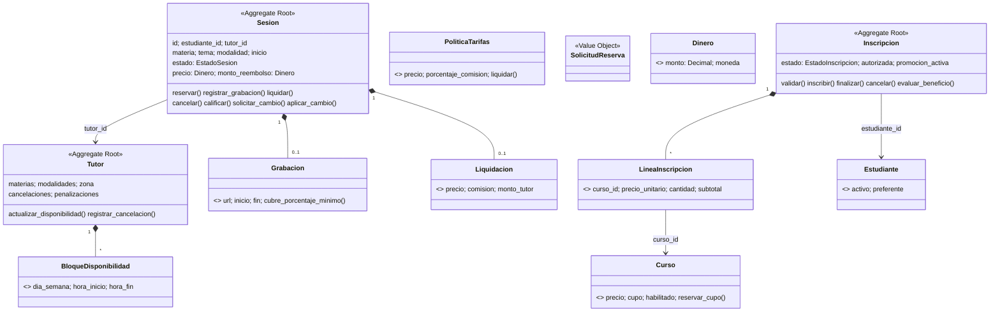
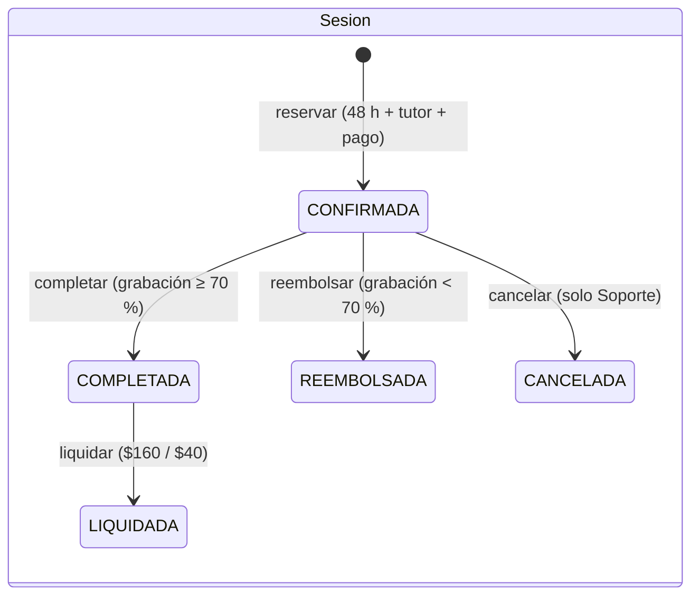
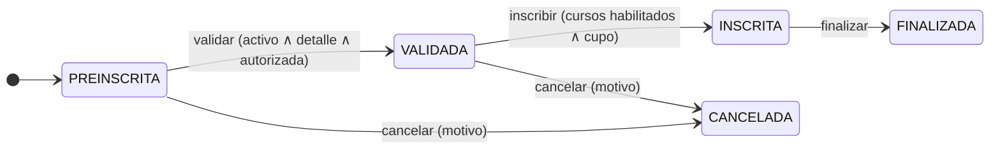
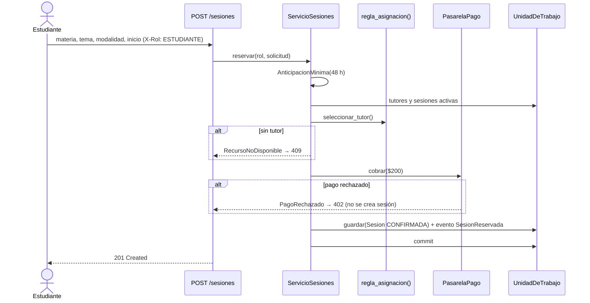

# Arquitectura y decisiones técnicas — AulaPlus

## 1. Capas (arquitectura hexagonal / DDD)

Las dependencias apuntan hacia el dominio: `domain` no importa nada de las otras capas; `application` solo conoce el dominio y los puertos; `infrastructure` y `api` son adaptadores intercambiables.

## 2. Modelo de dominio

## 3. Máquinas de estados

## 4. Secuencia: reservar sesión (US-01, US-02, US-03)

## 5. Patrones de diseño

| Patrón | Dónde | Por qué |
|---|---|---|
| Aggregate Root (DDD) | `Sesion`, `Tutor`, `Inscripcion` | Protegen sus invariantes; solo se modifican mediante sus métodos. |
| Value Object | `Dinero`, `Grabacion`, `Liquidacion`, `PoliticaTarifas`, `BloqueDisponibilidad`, `LineaInscripcion` | Inmutables y comparados por valor; validan en el constructor. |
| Specification | `src/domain/*/especificaciones.py` | Reglas con nombre de negocio combinables con AND/OR/NOT (ADR-004). |
| State Machine | `MaquinaEstados` | Transiciones explícitas y auditables (ADR-003). |
| Domain Events | `EventoDominio`, `AgregadoRaiz._registrar` | Registro de hechos ocurridos; se guardan en `eventos_dominio`. |
| Repository + Unit of Work | `puertos.py`, `repositorios_sql.py`, `memoria.py` | Aíslan la persistencia; una transacción por caso de uso. |
| Service Layer | `src/application/servicios_*.py` | Orquesta casos de uso sin lógica de negocio propia. |
| Adapter / Ports & Adapters | `PasarelaPago`, `Reloj` | Permite simular pagos y tiempo en pruebas y demo. |
| Factory | `create_app()`, `Sesion.reservar()` | Construcción controlada de la app y del agregado. |

## 6. Principios SOLID

| Principio | Evidencia |
|---|---|
| **S** — Responsabilidad única | Cada Specification evalúa una sola condición; `errores.py` solo traduce excepciones; `cargador_csv.py` solo lee CSV. |
| **O** — Abierto/cerrado | Se agregan reglas componiendo Specifications nuevas sin modificar las existentes; nuevas transiciones se agregan a la tabla. |
| **L** — Sustitución de Liskov | `UnidadDeTrabajoMemoria` y `UnidadDeTrabajoSQL` son intercambiables: las mismas pruebas de servicios funcionan con ambas. |
| **I** — Segregación de interfaces | Puertos pequeños y separados: `RepositorioTutores`, `RepositorioSesiones`, `PasarelaPago`, `Reloj`. |
| **D** — Inversión de dependencias | Los servicios reciben `UnidadDeTrabajo`, `PasarelaPago` y `Reloj` por constructor; FastAPI los inyecta con `Depends`. |

## 7. Decisiones técnicas (resumen)
- **Dinero:** `Decimal` construido desde texto; nunca `float` (umbral `>= 1500` y 80/20 exactos).
- **Tiempo:** todo se guarda en UTC; la disponibilidad se evalúa en hora de Monterrey (UTC-6 fijo). El 70 % se compara con `timedelta` exacto (63 min = 70 %).
- **Errores → HTTP:** 402 pago rechazado · 403 rol sin permiso · 404 no existe · 409 transición inválida o sin tutor/cupo · 422 datos inválidos o regla violada.
- **Eventos:** se registran solo después de una transición válida y se persisten al guardar el agregado.
- **Configuración:** variables de entorno (`DATABASE_URL`, `SEED_DATOS`, `PASARELA_RECHAZAR`, `APP_ENV`); ver `.env.example`.
- ADRs completos en [`adr/`](adr/).
